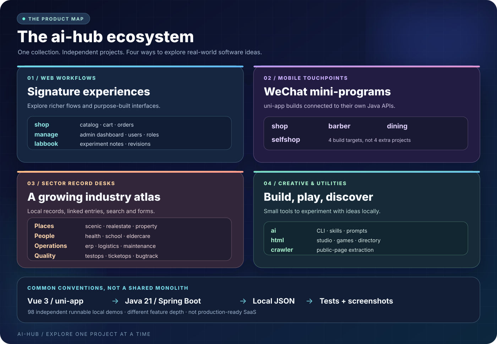

<div align="center">

**[简体中文](./README.md) · [English](./README.en.md)**


### Turn a real need into software you can see and run.

**102 independent runnable projects** &nbsp;·&nbsp; **4 WeChat mini-program builds** &nbsp;·&nbsp; **Vue 3 + Java 21** &nbsp;·&nbsp; **Local-first**

[Pick a project](#-start-here) · [Quick start](#-quick-start) · [Ecosystem matrix](#-ai-hub-ecosystem-matrix) · [All projects](#-explore-by-domain) · [Screenshots](#-screen-previews) · [Architecture](#-architecture-and-delivery) · [Docs & customization](#-documentation-and-customization)

</div>

<div align="center">

[](https://github.com/hickey-ai/ai-hub/actions/workflows/verify.yml)
[](./docs/project-catalog.en.md)
[](./docs/README.md)
[](./SECURITY.md)

[GitHub](https://github.com/hickey-ai/ai-hub) · [Gitee](https://gitee.com/codingdb/ai-hub)

</div>

> **ai-hub is a growing collection of business software projects.** Explore selected workflows, lightweight record desks for many professions, mini-programs and creative utilities. Pick one directory, run it, inspect the actual pages and adapt it to a concrete need. **Software for every profession is a vision, not a claim of complete industry coverage today.**

## ⭐ Start here

Pick a running page. Each project starts independently; you do not need to deploy the whole collection. [Follow the hands-on guide](./docs/getting-started.en.md).

<table>
<tr>
<td width="33%" align="center"><a href="./shop/README.md"></a><br/><b>Shop</b><br/><sub>Catalog · cart · demo order<br/>Local port 8081</sub></td>
<td width="33%" align="center"><a href="./manage/README.md"></a><br/><b>Manage</b><br/><sub>Dashboard · users · logs<br/>Local port 8082</sub></td>
<td width="33%" align="center"><a href="./authcenter/README.en.md"></a><br/><b>Authcenter</b><br/><sub>Demo login · tokens · audit<br/>Local port 8182</sub></td>
</tr>
</table>

<div align="center"><sub>Real application screenshots, not mockups. Click an image for features, more screens and limitations.</sub></div>

For research records, start with [labbook](./labbook/README.md); for other professions, browse the [full catalog](./docs/project-catalog.en.md). Found a useful starting point? [Star the GitHub project](https://github.com/hickey-ai/ai-hub), open an [Issue](https://github.com/hickey-ai/ai-hub/issues) or read the [contribution guide](./CONTRIBUTING.en.md).

## 🧩 ai-hub ecosystem matrix



| Layer | Projects / entry points | What to explore | Current scope |
| :--- | :--- | :--- | :--- |
| **Workflow applications** | [shop](./shop/README.md) · [manage](./manage/README.md) · [labbook](./labbook/README.md) | Storefront purchase flow, administration dashboard and experiment records | Feature depth varies; these are not complete production products |
| **Mobile touchpoints** | [shop](./shop/README.md) · [barber](./barber/README.md) · [dining](./dining/README.md) · [selfshop](./selfshop/README.md) | Four uni-app WeChat mini-program builds, each with its project's Java API | The **4 build targets are included within the 102 projects**, not additional systems |
| **Sector record desks** | [scenic](./scenic/README.md) · [realestate](./realestate/README.md) · [health](./health/README.md) · [erp](./erp/README.md) · [more sectors ↓](#-explore-by-domain) | Industry records, related entries, search and forms | Mostly single-user local demos; no real ticketing, diagnosis, closing or regulatory workflows |
| **Security and identity pilot** | [authcenter](./authcenter/README.en.md) · [manage API integration](./docs/auth-integration.md) | Local token signing, public-key discovery, audience restrictions and protected API validation | Local pilot only; no browser SSO, resource authorization, key rotation or ecosystem-wide rollout |
| **Creative utilities** | [ai](./ai/README.md) · [html](./html/README.md) · [crawler](./crawler/README.md) | CLI / skill workspace, HTML mini-games and directory demo, public-page crawling | Local utilities and demos, not a hosted AI platform or large-scale crawler |

**Shared delivery conventions, not a shared monolith:** Each project owns its directory, port and data file. Vue 3 pages are built and served by a Java 21 / Spring Boot application, with test scripts and actual screenshots. [See the architecture](#-architecture-and-delivery) · [Read the limits](#-verification-and-safety-limits)

<details>
<summary><b>Expand the animated sector constellation</b></summary>
<br/>

</details>

> **New this round:** [Parcel station](./parcelstation/README.md), [Recycling](./recycling/README.md), and [Childcare](./childcare/README.md). [Three-project checks and limits](./docs/priority-three-validation-2026-10-04.md) are separate from the historical 98-project validation snapshot.

> 💬 **Need something for your profession?** Add QQ **3174667330** to discuss custom development. Bring your use case, number of users and essential workflows. These runnable projects are starting points; a production deployment needs further design, implementation and acceptance testing.

## ⚡ Quick start

Install **Java 21, Maven, Node.js 20.19+/22.12+, and npm**. From the repository root (the first run downloads dependencies):

| Windows PowerShell | macOS / Linux |
| :--- | :--- |
| `./shop/run.ps1` | `./shop/run.sh` |

Open `http://127.0.0.1:8081`, then press `Ctrl+C` to stop. Follow the [hands-on guide](./docs/getting-started.en.md) for manage, authcenter and mini-program steps. Barber, dining and self-shopping are **mini-program-only**; their build output is not a desktop Web page.

## 🗂️ Explore by domain

**102 independent projects · 12 non-overlapping primary categories.** Release batches are no longer used as categories. Mini-program support is a **cross-cutting client type**, not four additional projects. Feature depth varies: consult each project README and the [validation matrix](./docs/project-validation-2026-10-03.md).

| Category | Projects | Start here | Complete list |
| :--- | ---: | :--- | :--- |
| Retail, dining & local services | 13 | [shop](./shop/README.md) · [barber](./barber/README.md) · [dining](./dining/README.md) | [Browse](./docs/project-catalog.en.md#commerce) |
| Enterprise & professional services | 13 | [manage](./manage/README.md) · [crm](./crm/README.md) · [auditfirm](./auditfirm/README.md) | [Browse](./docs/project-catalog.en.md#enterprise) |
| Supply chain, manufacturing & quality | 14 | [erp](./erp/README.md) · [wms](./wms/README.md) · [foodsafety](./foodsafety/README.md) | [Browse](./docs/project-catalog.en.md#supply) |
| Health, healthcare & eldercare | 10 | [hospital](./hospital/README.md) · [health](./health/README.md) · [eldercare](./eldercare/README.md) | [Browse](./docs/project-catalog.en.md#care) |
| Pet services | 4 | [petcare](./petcare/README.md) · [veterinary](./veterinary/README.md) | [Browse](./docs/project-catalog.en.md#pets) |
| Education, research & culture | 11 | [school](./school/README.md) · [labbook](./labbook/README.md) · [museum](./museum/README.md) | [Browse](./docs/project-catalog.en.md#education) |
| Mobility, tourism & events | 10 | [scenic](./scenic/README.md) · [transit](./transit/README.md) · [autosales](./autosales/README.md) | [Browse](./docs/project-catalog.en.md#mobility) |
| Property, parks & construction | 4 | [realestate](./realestate/README.md) · [property](./property/README.md) · [construction](./construction/README.md) | [Browse](./docs/project-catalog.en.md#places) |
| Agriculture, resources & environment | 7 | [agriculture](./agriculture/README.md) · [energy](./energy/README.md) · [water](./water/README.md) | [Browse](./docs/project-catalog.en.md#resources) |
| Public services & infrastructure | 6 | [gridops](./gridops/README.md) · [access](./access/README.md) · [civic](./civic/README.md) | [Browse](./docs/project-catalog.en.md#public) |
| Developer operations & digital tools | 8 | [testops](./testops/README.md) · [ticketops](./ticketops/README.md) · [authcenter](./authcenter/README.en.md) | [Browse](./docs/project-catalog.en.md#digital) |
| Home & personal planning | 2 | [schedule](./schedule/README.md) · [parenting](./parenting/README.md) | [Browse](./docs/project-catalog.en.md#personal) |

> “Software for every profession” is a vision, not a claim of complete industry coverage. The [full catalog](./docs/project-catalog.en.md) lists every project, its local scope, port and screenshot.

## 🖼️ Screen previews

Captured application pages, not design mockups. A screenshot is an entry point, not evidence of complete acceptance testing.

<table>
<tr><td width="50%" align="center"><a href="./barber/README.md"></a><br/><b>Barber booking · mini-program</b></td><td width="50%" align="center"><a href="./gridops/README.md"></a><br/><b>Grid cases · public services</b></td></tr>
<tr><td width="50%" align="center"><a href="./ai/README.md"></a><br/><b>AI tools · digital creation</b></td><td width="50%" align="center"><a href="./realestate/README.md"></a><br/><b>Real estate · property</b></td></tr>
</table>

[All 102 projects' screenshot links](./docs/screenshots.en.md) · [Project catalog](./docs/project-catalog.en.md).

## 🧭 Architecture and delivery


- **Independent apps, not one monolith:** each directory has its own Java 21/Spring Boot service and port. Vue 3 Web builds are served from their corresponding jars alongside same-origin `/api` endpoints.
- **Client types do not inflate the count:** shop has desktop and WeChat mini-program clients; barber, dining and selfshop are mini-program-only. These four builds are part of the 102.
- **Local data:** record-based examples use separate local JSON files. Consult each README for its backup/reset behavior. Default binding is `127.0.0.1`; **do not expose directly to the public internet**.

## ✅ Verification and safety limits

```powershell
./test-all.ps1     # Windows: all builds, backend tests and packaging checks
./smoke-test.ps1   # Windows: live-service page, asset and API smoke checks
```

Use `./test-all.sh` on macOS/Linux or `mvn -f <project>/backend/pom.xml test` for one backend. **On October 7, 2026, the Windows full-build script passed 102/102 project builds/packages, all four mini-program builds, 160 Maven tests across 118 Surefire reports (0 failures/errors/skips), and 16 root tooling tests.** The security-center pilot also passed a live browser login/session-clear check and a 401/200/401 token integration with the manage API. Historical service/browser checks covered 98 projects and 80 sector demos respectively; see the [per-project evidence](./docs/project-validation-2026-10-03.md). This is **not** exhaustive browser, device, business-flow or production acceptance for all 102. The [quality ledger](./docs/quality-loop.md) records only rounds actually executed; the scheduled follow-up has been cancelled.

> [!IMPORTANT]
> **Authentication pilot:** The local [security and identity center](./authcenter/README.en.md) issues RSA JWTs and publishes JWKS; the [manage API](./manage/README.md) can validate them when configured. Its browser UI has no SSO login or server-side RBAC, and the other 100 business projects remain unintegrated. See the [security inventory and setup](./docs/auth-integration.md) (Chinese).

> These are runnable local starting points, **not production-ready business systems**. Unified authentication/authorization, real payments, encryption, tamper-proof audit, database migrations and concurrency guarantees are not universally provided. Do not enter real sensitive medical, financial, child, access-control or research data. A mini-program build is not a WeChat device acceptance test; production requires dedicated security, privacy, compliance, backup and business verification.

## 📚 Documentation and customization

[Getting started](./docs/getting-started.en.md) · [Full catalog](./docs/project-catalog.en.md) · [All screenshots](./docs/screenshots.en.md) · [Product matrix & gaps](./docs/product-matrix.en.md) · [Strategic-software gaps](./docs/strategic-software-gap.en.md) · [Manufacturing stages](./docs/strategic-software-design.en.md) · [Documentation guide](./docs/README.md) · [Validation matrix](./docs/project-validation-2026-10-03.md) · [Research map (Chinese)](./docs/business-map.md) · [Contributing](./CONTRIBUTING.en.md) · [Security](./SECURITY.md) · [Changelog](./CHANGELOG.md)

The 12 customer-domain categories are not software revenue categories. Sector demos do not imply that an OS, database or industrial design suite has been delivered; the matrix and gap analysis distinguish working examples from unmet milestones.

If you have a concrete workflow and user base in mind, we can discuss custom development starting from a relevant project. **QQ 3174667330 · 3174667330@qq.com**.
