<div align="center">

**[简体中文](./README.md) · [English](./README.en.md)**

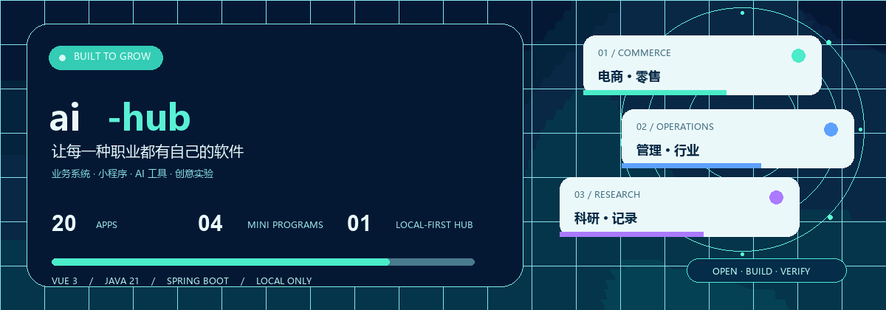

### 把每一种真实需求，变成看得见的软件。

**102 个独立可运行项目** &nbsp;·&nbsp; **4 个微信小程序构建** &nbsp;·&nbsp; **Vue 3 + Java 21** &nbsp;·&nbsp; **本机优先**

[选择一个项目](#-从这里开始) · [快速开始](#-快速开始) · [生态矩阵](#-ai-hub-生态矩阵) · [全部项目](#-按业务找项目) · [页面截图](#-页面预览) · [架构与边界](#-架构与交付边界) · [文档与定制](#-文档导航与定制)

</div>

<div align="center">

[](https://github.com/hickey-ai/ai-hub/actions/workflows/verify.yml)
[](./docs/project-catalog.md)
[](./docs/README.md)
[](./SECURITY.md)

[GitHub](https://github.com/hickey-ai/ai-hub) · [Gitee](https://gitee.com/codingdb/ai-hub)

</div>

> **ai-hub 是持续生长的业务软件合集。** 从有完整交互流程的精选项目，到覆盖更多职业的轻量记录样板，再到小程序和创意工具：选一个目录，运行、查看页面、验证功能，然后按自己的业务继续改造。**“让每种职业都有软件”是愿景，不是已经覆盖所有行业流程的承诺。**

## ⭐ 从这里开始

选一个实际运行的页面开始；每个项目都可独立启动，无需先部署整套生态。[照步骤运行与体验](./docs/getting-started.md)。

<table>
<tr>
<td width="33%" align="center"><a href="./shop/README.md">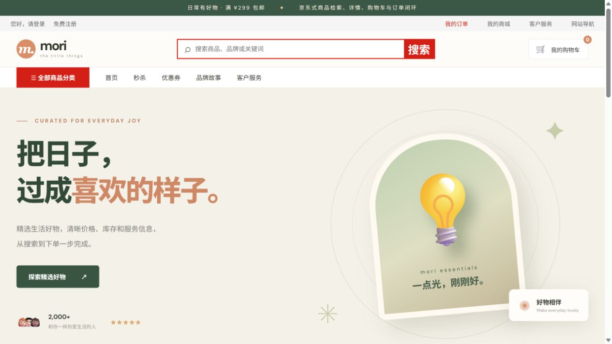</a><br/><b>商城</b><br/><sub>商品浏览 · 购物车 · 演示订单<br/>本机 8081</sub></td>
<td width="33%" align="center"><a href="./manage/README.md">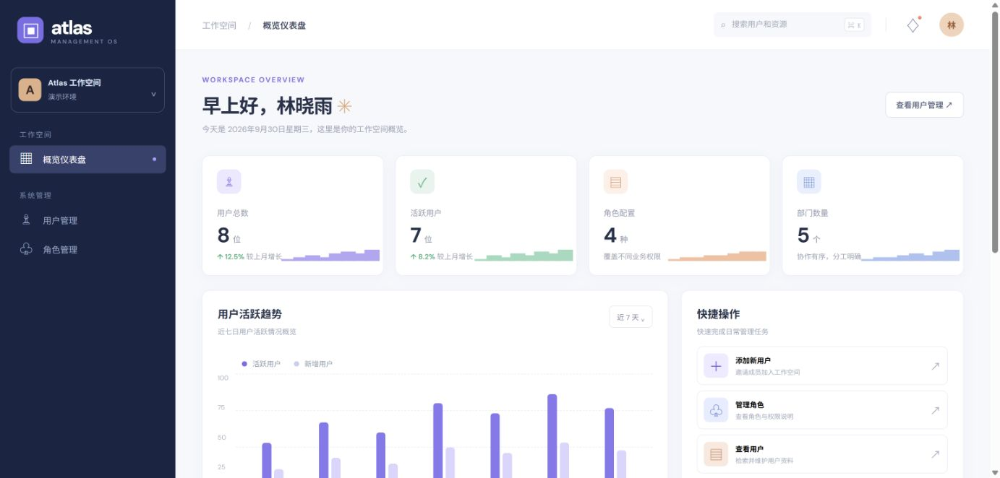</a><br/><b>管理后台</b><br/><sub>控制台 · 用户管理 · 操作日志<br/>本机 8082</sub></td>
<td width="33%" align="center"><a href="./authcenter/README.md">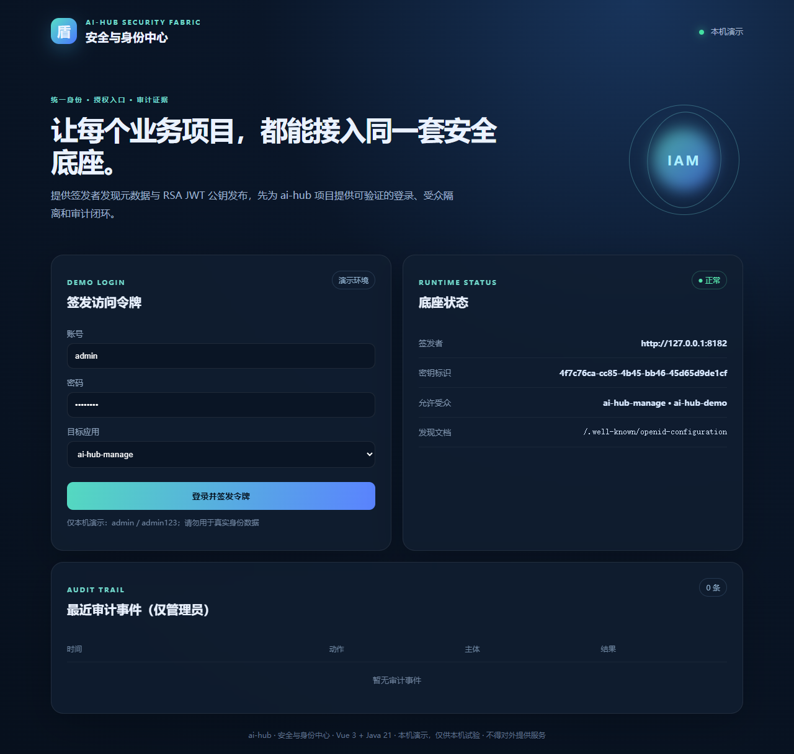</a><br/><b>安全与身份中心</b><br/><sub>演示登录 · 令牌 · 审计<br/>本机 8182</sub></td>
</tr>
</table>

<div align="center"><sub>真实运行页面，不是效果图。点击图片查看功能、更多截图和使用边界。</sub></div>

## ⚡ 快速开始

准备 **Java 21、Maven、Node.js 20.19+/22.12+ 和 npm**。先选商城，在**仓库根目录**运行：

```powershell
./shop/run.ps1
```

macOS/Linux 运行 `./shop/run.sh`。首次执行会联网安装依赖、构建前端、运行后端测试并启动服务，耗时取决于网络与本机环境。看到启动完成日志后，打开 `http://127.0.0.1:8081`，按 `Ctrl+C` 停止。

也可选择下面一项，在单独终端运行：

| 项目 | Windows PowerShell | macOS / Linux | 本机页面 |
| :--- | :--- | :--- | :--- |
| 管理后台 | `./manage/run.ps1` | `./manage/run.sh` | `http://127.0.0.1:8082` |
| 安全与身份中心 | `./authcenter/run.ps1` | `./authcenter/run.sh` | `http://127.0.0.1:8182` |

[完整体验步骤与演示账号](./docs/getting-started.md)。理发、点餐、自助购物只有小程序界面，需要微信开发者工具体验。

科研记录可从[实验记录](./labbook/README.md)开始；其他职业请看[完整分类目录](./docs/project-catalog.md)。找到有用的起点，欢迎在 [GitHub 点 Star](https://github.com/hickey-ai/ai-hub)；发现问题或有真实业务流程，可提交 [Issue](https://github.com/hickey-ai/ai-hub/issues) 或阅读[贡献指南](./CONTRIBUTING.md)。

## 🧩 ai-hub 生态矩阵

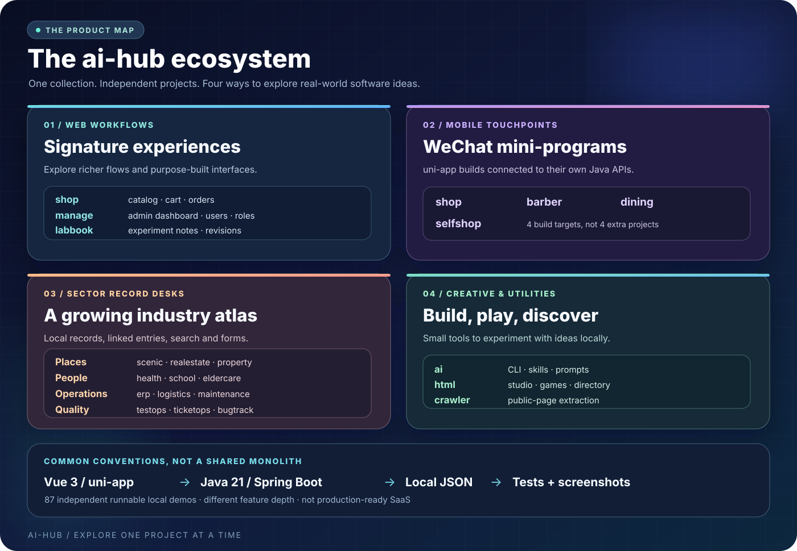

| 生态层 | 代表项目 / 入口 | 你能体验到什么 | 当前边界 |
| :--- | :--- | :--- | :--- |
| **业务流程应用** | [商城](./shop/README.md) · [管理后台](./manage/README.md) · [实验记录](./labbook/README.md) | 商城购买链路、管理控制台、实验记录等各有侧重的独立体验 | 功能深度不一致；不等于生产级全功能产品 |
| **移动端触点** | [商城](./shop/README.md) · [理发预约](./barber/README.md) · [点餐](./dining/README.md) · [自助购物](./selfshop/README.md) | 四个项目的微信小程序构建，连接各自的后端接口 | **4 个构建目标包含在 102 个项目内**，不是额外四套系统 |
| **行业记录样板** | [景区管理](./scenic/README.md) · [房产管理](./realestate/README.md) · [健康管理](./health/README.md) · [企业资源管理](./erp/README.md) · [更多行业 ↓](#-按业务找项目) | 行业档案、关联记录、搜索和表单；用来讨论具体业务需求 | 多数为本机单用户记录演示，不含真实票务、诊断、交易或监管流程 |
| **安全与身份底座** | [安全与身份中心](./authcenter/README.md) · [管理后台接口接入](./docs/auth-integration.md) | 本机令牌签发、公钥发现、受众隔离与管理接口令牌校验 | 仅本机试点；浏览器登录、资源级授权、密钥轮换及其余业务项目接入未完成 |
| **创意与效率工具** | [智能工具](./ai/README.md) · [网页创意](./html/README.md) · [网页采集](./crawler/README.md) | 命令行与技能工作台、网页小游戏与黄页样板、公开页面抓取 | 本机工具与演示，不是托管式智能平台或大规模爬虫服务 |

**共同的交付方式，不是共享单体服务：**各项目独立目录、独立端口；需保存记录的业务项目使用各自的本机数据文件；网页经构建后由各自的后端服务提供，配有测试脚本和实际截图。[看完整架构](#-架构与交付边界) · [看使用边界](#-测试证据与安全边界)

<details>
<summary><b>展开 ai-hub 业务星图动效</b></summary>
<br/>
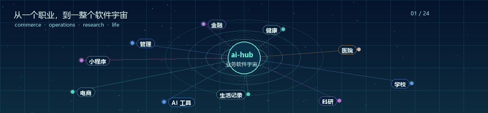
</details>

> 💬 **你的行业还缺合适的软件？** 可加 QQ **3174667330** 讨论定制开发：告诉我们业务场景、使用人数与期待的流程。现有项目是可以运行和验证的起点，正式上线需要进一步设计、开发与验收。

## 🗂️ 按业务找项目

**102 项 · 12 个互斥主分类。** 不再按“本轮新增／上一轮新增”排列；新增时间不是行业分类。小程序是**跨分类的交付形态**，不另计 4 个项目；精选业务体验与行业记录样板的深度不同，请看每项的 README 和[测试矩阵](./docs/project-validation-2026-10-03.md)。

| 主分类 | 项目数 | 推荐入口 | 完整目录 |
| :--- | ---: | :--- | :--- |
| 零售餐饮与生活服务 | 13 | [商城](./shop/README.md) · [理发预约](./barber/README.md) · [点餐](./dining/README.md) | [查看全部](./docs/project-catalog.md#commerce) |
| 企业经营与专业服务 | 13 | [管理后台](./manage/README.md) · [客户关系](./crm/README.md) · [审计](./auditfirm/README.md) | [查看全部](./docs/project-catalog.md#enterprise) |
| 供应链、制造与质量 | 14 | [进销存](./erp/README.md) · [仓储](./wms/README.md) · [食品批次](./foodsafety/README.md) | [查看全部](./docs/project-catalog.md#supply) |
| 医疗健康与养老 | 10 | [医院](./hospital/README.md) · [健康](./health/README.md) · [养老](./eldercare/README.md) | [查看全部](./docs/project-catalog.md#care) |
| 宠物服务 | 4 | [宠物照护](./petcare/README.md) · [宠物诊所](./veterinary/README.md) | [查看全部](./docs/project-catalog.md#pets) |
| 教育、科研与文化 | 11 | [学校](./school/README.md) · [实验记录](./labbook/README.md) · [博物馆](./museum/README.md) | [查看全部](./docs/project-catalog.md#education) |
| 出行、文旅与活动 | 10 | [景区](./scenic/README.md) · [公交地铁](./transit/README.md) · [汽车销售](./autosales/README.md) | [查看全部](./docs/project-catalog.md#mobility) |
| 地产、园区与工程 | 4 | [房产交易](./realestate/README.md) · [物业](./property/README.md) · [工程](./construction/README.md) | [查看全部](./docs/project-catalog.md#places) |
| 农林渔矿、能源与环境 | 7 | [农业](./agriculture/README.md) · [能源](./energy/README.md) · [水务](./water/README.md) | [查看全部](./docs/project-catalog.md#resources) |
| 公共服务与设施安全 | 6 | [网格事件](./gridops/README.md) · [门禁](./access/README.md) · [公共服务](./civic/README.md) | [查看全部](./docs/project-catalog.md#public) |
| 研发协作与数字工具 | 8 | [测试管理](./testops/README.md) · [内部工单](./ticketops/README.md) · [安全与身份中心](./authcenter/README.md) | [查看全部](./docs/project-catalog.md#digital) |
| 家庭与日程 | 2 | [日程](./schedule/README.md) · [养娃](./parenting/README.md) | [查看全部](./docs/project-catalog.md#personal) |

> **本轮新增：**[快递驿站](./parcelstation/README.md)、[再生资源回收](./recycling/README.md)、[托育机构](./childcare/README.md)。三项专项验证与边界见[记录](./docs/priority-three-validation-2026-10-04.md)；历史 98 项验证快照不代表新项目已接受全量测试。

> **找不到你的职业？** 先从相近场景的档案、表单和记录流程出发；“所有职业都能找到软件”是长期愿景，并非当前已实现所有行业流程。完整的 102 项逐一列出功能、运行端口和截图：[项目分类目录](./docs/project-catalog.md)。

## 🖼️ 页面预览

以下链接是实际运行页面的仓库截图，不是效果图；图片只是入口，不代表所有页面的完整验收。

<table>
<tr><td width="50%" align="center"><a href="./barber/README.md">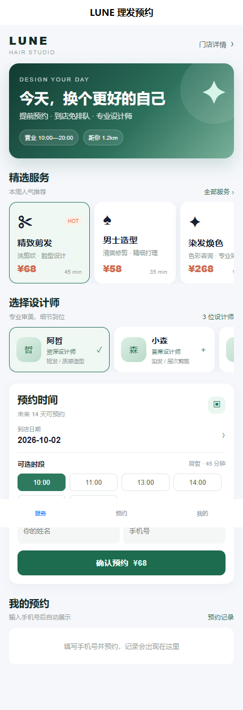</a><br/><b>理发预约 · 小程序</b></td><td width="50%" align="center"><a href="./gridops/README.md">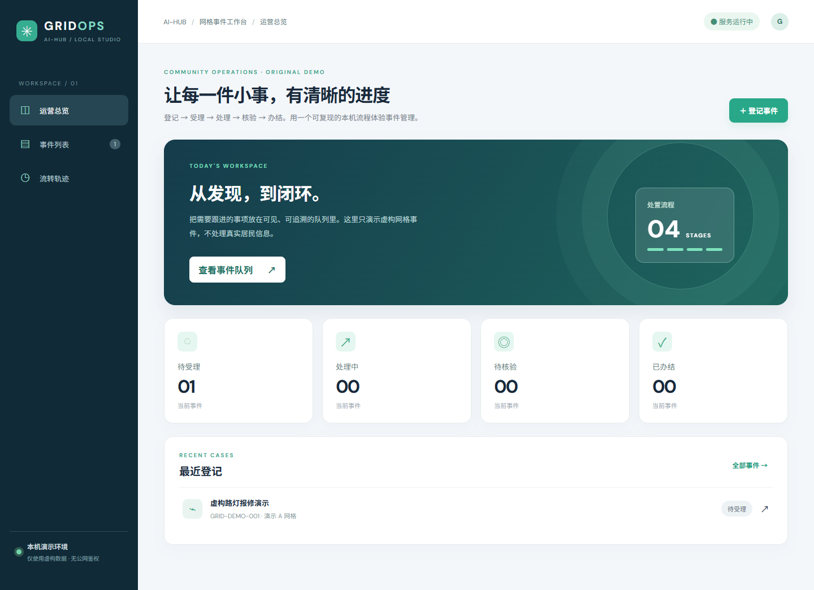</a><br/><b>网格事件 · 公共服务</b></td></tr>
<tr><td width="50%" align="center"><a href="./ai/README.md">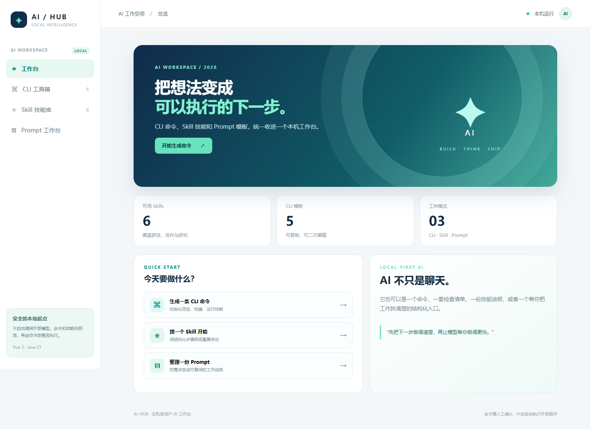</a><br/><b>智能工具 · 数字创作</b></td><td width="50%" align="center"><a href="./realestate/README.md">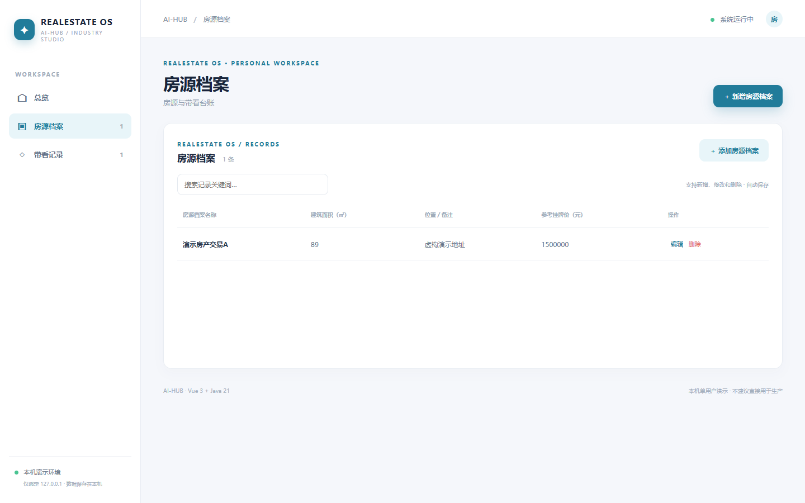</a><br/><b>房产交易 · 地产服务</b></td></tr>
</table>

**全部页面：**[102 项截图索引](./docs/screenshots.md) · [各项目独立 README](./docs/project-catalog.md)。

## 🧭 架构与交付边界

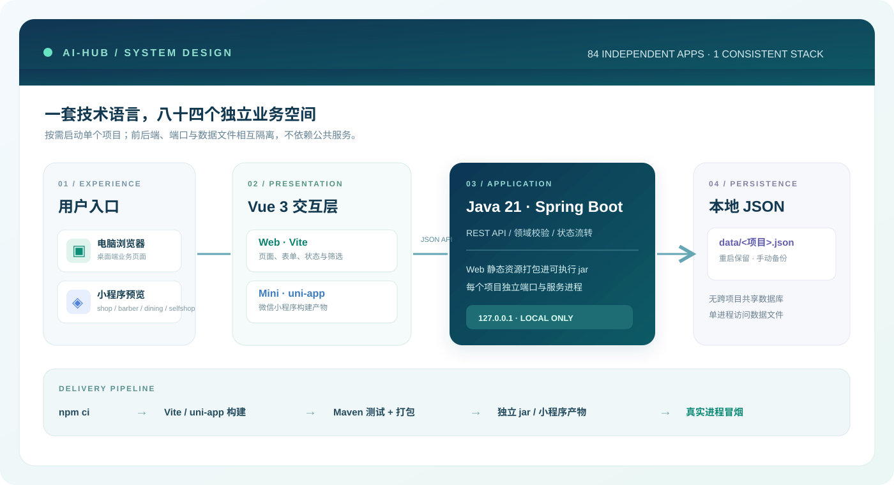

- **独立项目，不是一个单体平台：**每个目录有自己的 Java 21/Spring Boot 服务和端口，前端使用 Vue 3；Web 前端构建后由对应 jar 提供静态页面与同源 `/api`。
- **双端形态不重复计数：**商城包含电脑端和微信小程序；理发、点餐、自助购物目前仅有小程序。四个小程序构建目标均包含在 102 个项目中。
- **本机数据：**记录类项目以各自本地 JSON 文件保存演示数据；停服备份/重置方式及特殊项目请以对应 README 为准。默认 `127.0.0.1`，**不可直接对公网开放**。

## ✅ 测试证据与安全边界

```powershell
./test-all.ps1     # Windows：全量前端/小程序构建、后端测试与打包检查
./smoke-test.ps1   # Windows：启动服务后的页面、静态资源、API 冒烟
```

macOS/Linux 可运行 `./test-all.sh`；单项目运行 `mvn -f <项目>/backend/pom.xml test`。**2026-10-07 本机重跑 `./test-all.ps1`：102/102 项前端/后端构建与打包、4/4 个小程序构建通过；118 份 Surefire 报告共 160 项测试，0 失败、0 错误、0 跳过；根目录 16 项工具测试通过。**新增安全中心还完成了本机浏览器登录/清除会话验证，以及与管理后台 API 的 401/200/401 令牌联调。历史 98 项服务冒烟与 80 个行业记录样板浏览器流程检查见[逐项目记录](./docs/project-validation-2026-10-03.md)；本轮没有对 102 项逐页面、微信真机或真实业务流程全面验收。[100 轮自查账本](./docs/quality-loop.md)仅记录已实际执行的历史轮次，定时自查已取消。

> [!IMPORTANT]
> 这些是本机体验与二次开发起点，**不是可直接用于真实业务的生产系统**。未统一实现登录鉴权、权限隔离、真实支付、加密、审计、数据库迁移和并发保障。医疗、金融、未成年人、门禁及科研等敏感数据不要直接录入；小程序构建不等于微信真机验收。正式上线需单独完成安全、隐私、合规、备份与业务验收。

### 鉴权现状

新增[安全与身份中心](./authcenter/README.md)本机试点，提供 JWT 签发、JWKS 公钥发现、受众隔离及管理员审计；[管理后台 API](./manage/README.md) 可配置 `aihub.auth.issuer-uri=http://127.0.0.1:8182` 和 `aihub.auth.audience=ai-hub-manage` 校验令牌。**这不是全生态统一鉴权**；浏览器单点登录、角色/数据权限与其余 100 个业务项目接入仍未完成。[查看鉴权盘点、配置与测试边界](./docs/auth-integration.md)。

## 📚 文档导航与定制

[快速开始](./docs/getting-started.md) · [完整分类](./docs/project-catalog.md) · [全部截图](./docs/screenshots.md) · [产品矩阵与缺口验收](./docs/product-matrix.md) · [国家战略软件缺口](./docs/strategic-software-gap.md) · [制造工单阶段设计](./docs/strategic-software-design.md) · [架构说明](./docs/README.md) · [验证矩阵](./docs/project-validation-2026-10-03.md) · [建设调研](./docs/business-map.md) · [贡献指南](./CONTRIBUTING.md) · [安全策略](./SECURITY.md) · [版本记录](./CHANGELOG.md)

业务场景的 12 类分类不等同于软件业收入分类；行业样板也不代表已经交付操作系统、数据库或工业设计软件。上面的产品矩阵和战略软件缺口文件分别列出已实现内容与待验收事项。

你愿意讲清楚业务场景、用户规模和关键流程，我们就能从现有项目出发讨论定制开发。**QQ 3174667330 · 3174667330@qq.com**。
