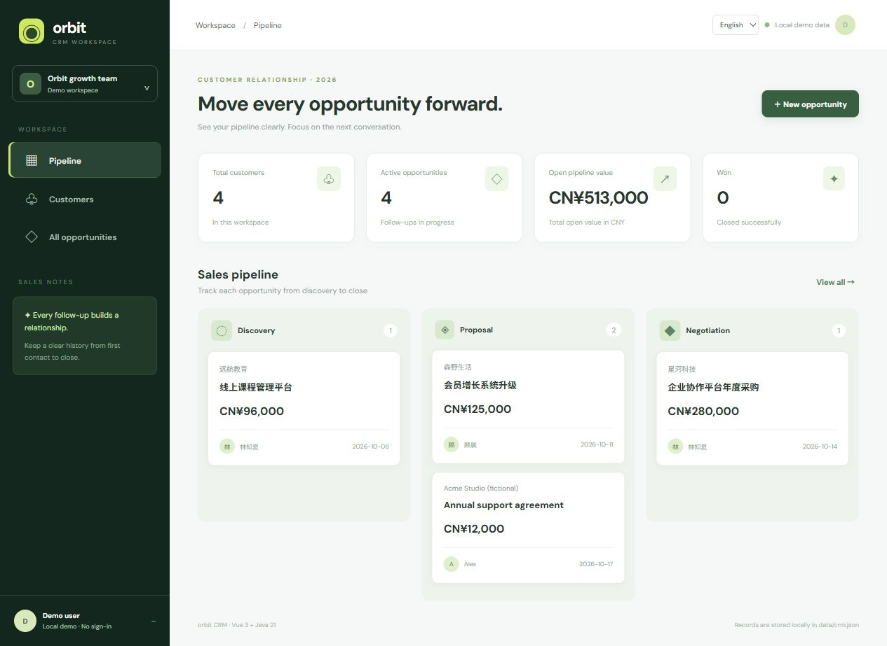
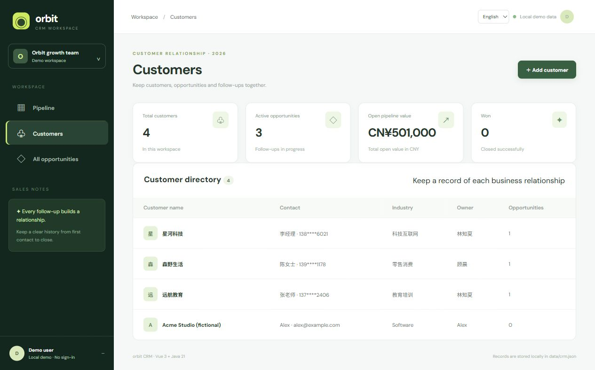
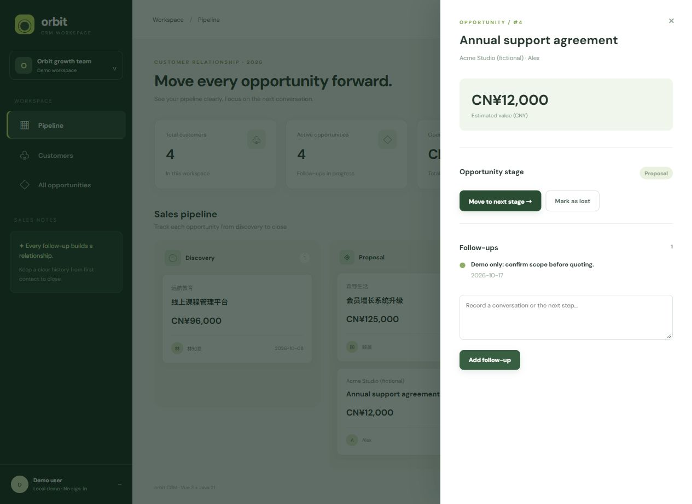
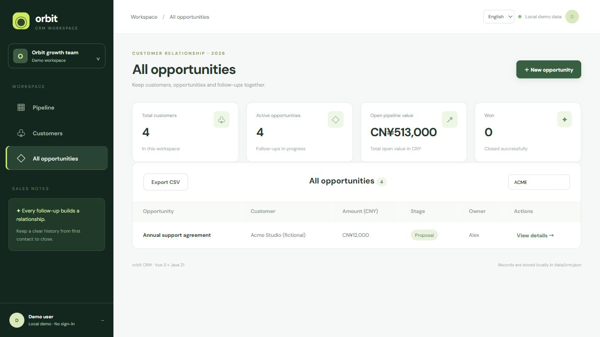
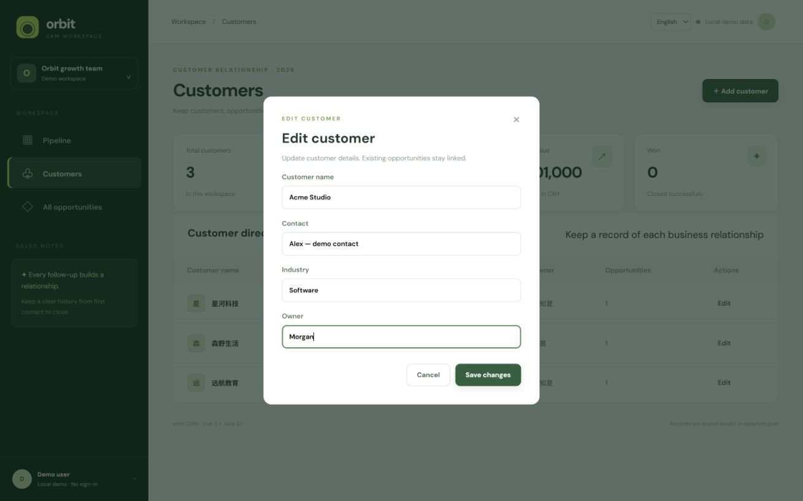
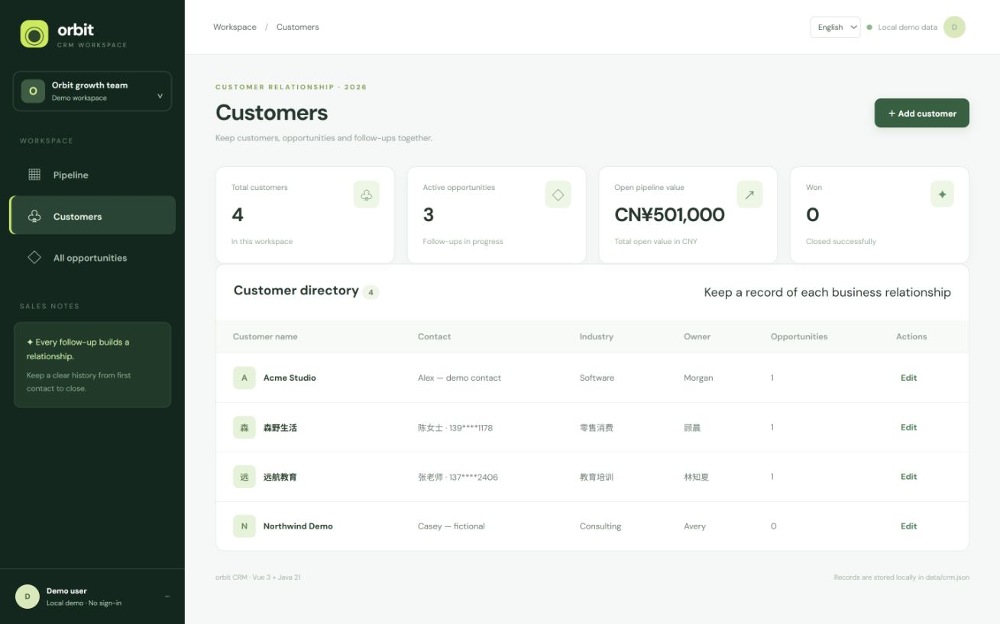
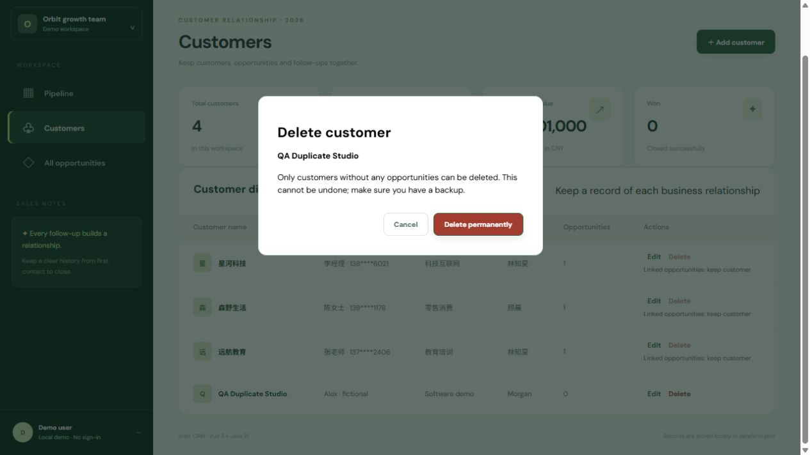
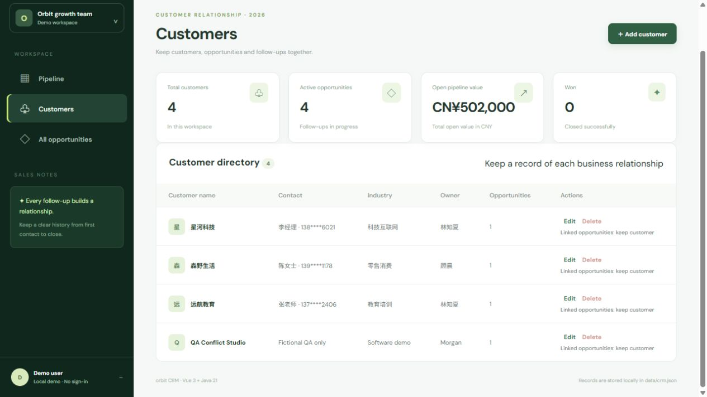
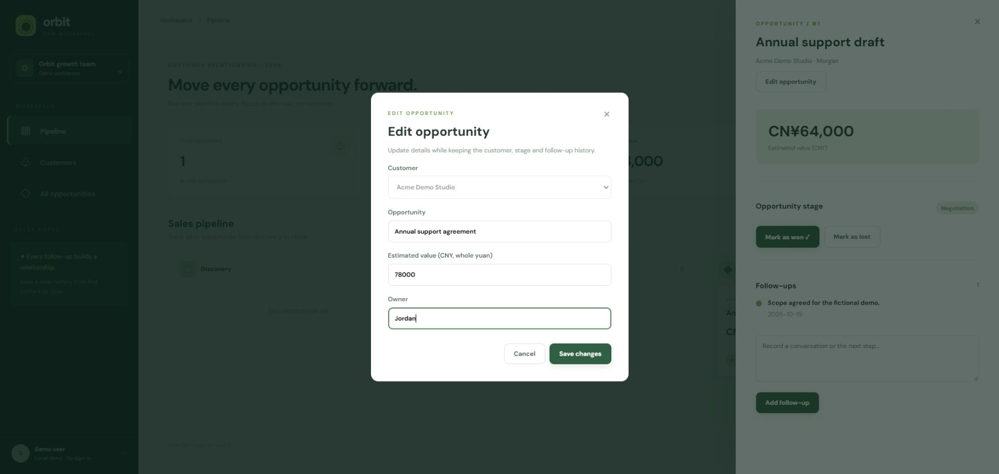
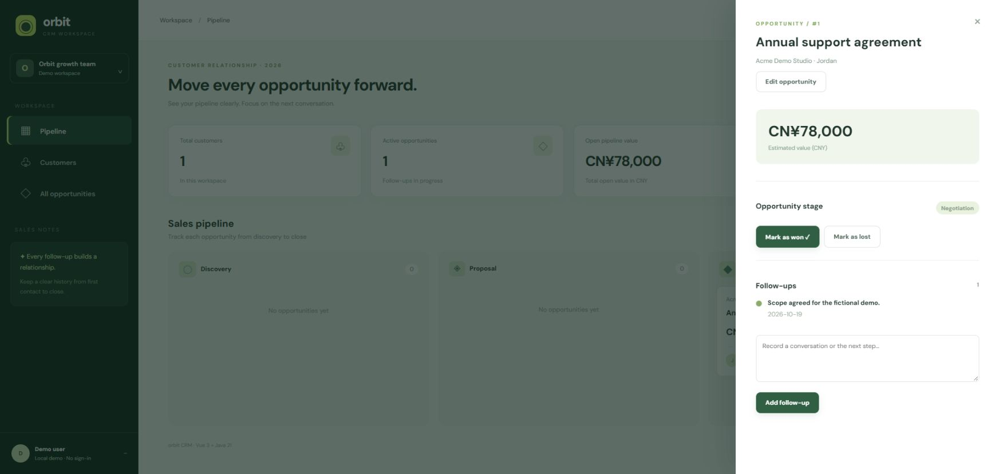

# orbit CRM — customer and opportunity workspace

[简体中文](./README.md) · **English**

A local workspace for customer records, a three-stage sales pipeline, follow-up notes and won/lost outcomes. Built with Vue 3 and Java 21 / Spring Boot. Switch between English and Chinese in the top bar; the choice is saved in this browser. Existing business records are preserved in their original language.



<details>
<summary>Customers, follow-up and filtered CSV export</summary>





</details>

## Run it

Requirements: Java 21, Maven, Node.js 20.19+ or 22.12+, and npm. From the `crm` directory:

```powershell
./run.ps1
```

```sh
./run.sh
```

The launcher installs dependencies, builds the frontend, runs backend tests and starts one application at **http://127.0.0.1:8083**. The first run needs internet access to download dependencies. Stop with Ctrl+C.

## Try a complete workflow

1. Choose **English** in the language selector. Open **Customers**, then **Add customer**; use fictional details for demonstrations.
2. Open **Pipeline** and create an opportunity for that customer. Amounts are **CNY, in whole yuan**; language switching never changes the currency or converts values.
3. Open the opportunity, add a follow-up, and move through Discovery → Proposal → Negotiation → Won. You may mark an open opportunity as Lost. Closed opportunities cannot be reopened or edited through these actions.
4. Open **All opportunities**, search by opportunity, customer or owner, then **Export CSV**. Export includes only matching rows, IDs, customer names, CNY values, stages, owners and creation dates. Headers and stages use the selected UI language. Business text stays unchanged.

CSV uses UTF-8 with BOM and quoted fields. Formula-like cell prefixes are escaped for spreadsheet import; treat exports as untrusted data and do not remove the protection or enable external spreadsheet content. CSV is a report, **not a restorable backup**, and no import feature is included.

## Find a customer

In **Customers**, search by name, contact, industry or owner. Matching ignores letter case and surrounding spaces and supports Chinese text. The count shows matching / total customers. **Clear search** restores the full directory when there are no matches. Searching only filters this view: it does not delete records or change opportunity links, and it is separate from the opportunity search.

## Edit customer details

In **Customers**, choose **Edit** beside a customer. Update the name, contact, industry or owner, then choose **Save changes**. **Cancel** leaves the saved record unchanged. The customer ID and existing opportunity links stay the same; opportunity displays, search and CSV exports use the updated customer name. Blank required fields are rejected. If saving fails, the form keeps your input and shows an error so you can correct it and retry. Changes use the same local JSON storage and backup procedure described below.




## Remove an unused customer

In **Customers**, choose **Delete** for a customer with no opportunities. The confirmation names the customer and focuses **Cancel** first. Cancel or Escape leaves the record unchanged; **Delete permanently** removes it from the directory and updates the total. Make a backup first: there is no undo or recycle bin.

Customers linked to any opportunity, including won or lost opportunities, cannot be deleted. The API checks this again at deletion time and returns HTTP 409 if another operation linked an opportunity after the dialog opened. It never deletes opportunities or follow-up history. If saving fails, the customer stays in the list and the dialog shows an error; correct the problem before retrying. Deletion is saved to the same local JSON file and deleted IDs are not reused.




## Edit an open opportunity

Open an opportunity from **Pipeline** or **All opportunities**, then choose **Edit opportunity**. Update its title, estimated value or owner and choose **Save changes**; **Cancel** discards unsaved edits. Values must be positive whole yuan: the API rejects fractional amounts rather than rounding or truncating them, for both new and edited opportunities.

The customer selector is locked while editing. Opportunity ID, customer link, stage, creation date and follow-up history stay unchanged. The pipeline total, search results and CSV report reflect saved details. Won and lost opportunities cannot be edited; the server also rejects a save if the opportunity closed after the form opened. A failed save keeps the form input for correction. These updates do not add an audit log or multi-user access control.




## Correct a follow-up note

Open an **open** opportunity and choose **Edit follow-up** beside a note. Correct the text and choose **Save changes**. Cancel or Escape discards unsaved edits. The note keeps its ID, original date, list position and opportunity link; multiline text is preserved. Blank notes are rejected. This is a correction of the existing note, with no revision history or audit log; back up the local data before changes you need to retain.

Won or lost opportunities cannot be edited. The API also rejects a save with HTTP 409 if the opportunity closed after the editor opened, and returns 404 for a note outside the specified opportunity. A failed save leaves the existing record unchanged and keeps the editor text for retry. Only one local application process should access the data file.

## Data and backups

Records are saved to `data/crm.json`, relative to the launcher directory. Stop the application before copying the file for backup or restoring a copy. Do not run multiple instances against one file. To reset fictional demonstration data, stop the application, back up and remove this file, then restart. A damaged file fails startup instead of silently resetting your records. Initial sample records are Chinese; English records can be added using the form.

## Verify a change

```sh
npm --prefix frontend ci
npm --prefix frontend test
npm --prefix frontend run build
mvn -f backend/pom.xml test
```

The frontend tests cover customer search across fields, CSV quoting, formula prefixes, filtered exports and translated stage presentation. Backend tests cover the business API and persistence. Run the launcher to verify the packaged frontend as well.

## Current scope

This is a **single-user local application**, not a hosted multi-tenant service. It has no sign-in, role enforcement, audit log, payment integration or email integration. The owner is a text field. It binds to `127.0.0.1` by default. Add and verify server-side authentication, authorization and data isolation before any public deployment. Do not use real customer data in public screenshots.
