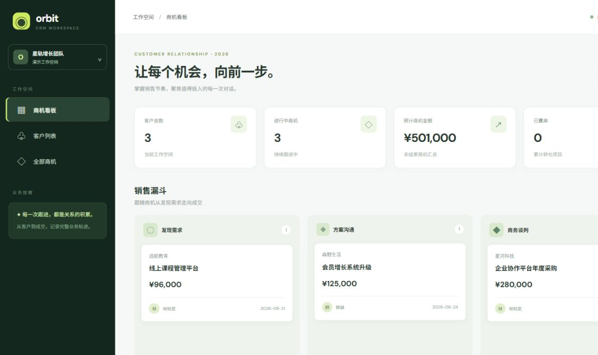

# CRM · orbit 客户关系样板

**简体中文** · [English](./README.en.md)



客户建档、商机创建、跟进记录、合法阶段推进及赢单/流失。 Vue 3 + Java 21/Spring Boot；页面截图来自本地实际运行。

## 一键运行

需要 Java 21、Maven、Node.js 20.19+/22.12+ 和 npm；在本目录执行：

```powershell
./run.ps1           # Windows PowerShell
```

```sh
./run.sh            # macOS / Linux
```

首次执行会下载依赖、构建前端、运行后端测试并启动单个 jar。浏览器打开 **http://127.0.0.1:8083**，前后端同一端口，无需另开终端。按 Ctrl+C 停止。Windows 如有旧 Vite 开发服务占用 `frontend/node_modules`，请先关闭再运行。

数据保存在本项目 `data/crm.json`，停止服务后可复制备份；如需恢复默认演示数据，停止后删除该文件并重启。文件损坏时启动会报错，不会自动清空。不要多个进程共用此文件。

英文运行实图：[商机看板](./screenshots/pipeline-en.png) · [客户列表](./screenshots/customers-en.png) · [跟进详情](./screenshots/followup-en.png) · [筛选导出](./screenshots/export-en.png)

## 中英文界面与商机导出

右上角可切换中文/English，语言偏好保存在当前浏览器；客户、商机、跟进等已有业务数据不自动翻译。金额始终为人民币整元，英文模式不会换算为美元。

在“全部商机”搜索客户、商机或负责人，点击“导出 CSV”即可导出当前筛选结果。文件包含编号、客户、金额、阶段、负责人和创建日期，表头和阶段跟随界面语言。支持带逗号、引号、换行的内容，并对表格公式前缀做防护。CSV 是报表，不是可恢复备份；恢复数据仍须停服后备份/还原 `data/crm.json`。

## 编辑客户资料

在“客户列表”点击对应客户的“编辑”，修改客户名称、联系人、行业或负责人后保存；“取消”不会改动已保存资料。编辑保留客户编号及已有商机关联，商机页面、搜索和 CSV 导出使用更新后的客户名称。空白必填字段会被拒绝；保存失败时保留输入并显示错误，修正后可以重试。数据仍保存在本机 JSON 文件中。


## 清理未使用的客户

在“客户列表”为没有关联商机的客户点击“删除”，确认框会显示客户名称，默认聚焦“取消”。取消或 Escape 保留记录；“确认删除”移除该客户并刷新总数。请先备份：没有撤销或回收站。

任何关联商机（包括已赢单、已流失）都会阻止删除。即使确认框打开后才新增商机关联，服务端也会重新校验并返回 HTTP 409；不会级联删除商机或跟进记录。保存失败时保留客户和确认框，显示错误，修正问题后可以重试。删除结果保存在原本机 JSON 文件，已删除客户编号不复用。


## 编辑进行中的商机

从“商机看板”或“全部商机”打开详情，点“编辑商机”，修改名称、预计金额或负责人后“保存修改”；“取消”放弃未保存的修改。金额必须为正的人民币整元；新增和编辑接口都会拒绝小数，不做静默取整。

编辑时锁定客户选择；商机编号、客户关联、阶段、创建日期与跟进记录保持不变。看板金额、搜索及 CSV 报表使用保存后的资料。已赢单或流失的商机不可编辑；即使表单打开后商机才结束，服务端也会拒绝保存。保存失败时保留输入供修正。这不包含变更审计或多人权限控制。


## 测试

```sh
mvn -f backend/pom.xml test
npm --prefix frontend ci
npm --prefix frontend test
npm --prefix frontend run build
```

在仓库根目录执行 `./test-all.ps1`（Windows）或 `./test-all.sh`（macOS / Linux）会验证目录中的全部项目及 jar 中的页面资源。前端截图参见上方。

**使用边界：**负责人只是文本字段；没有身份认证、审计或多人协作冲突处理。 默认只监听本机 `127.0.0.1`；这是可本地直接使用的样板，**不适合未经改造部署到公网或生产环境**。
